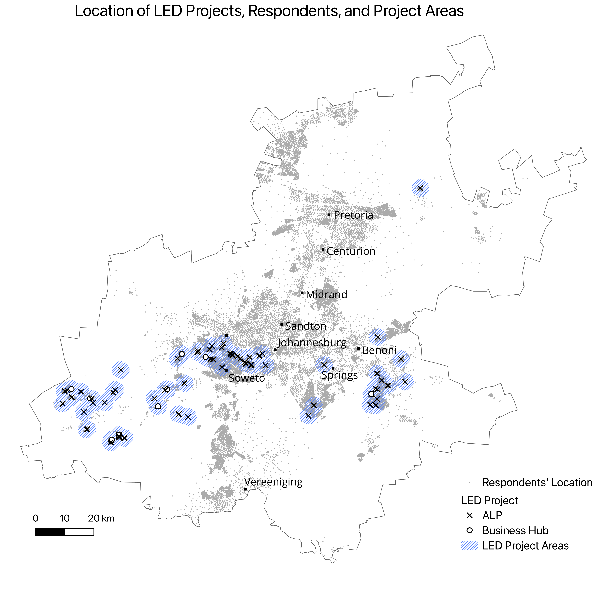
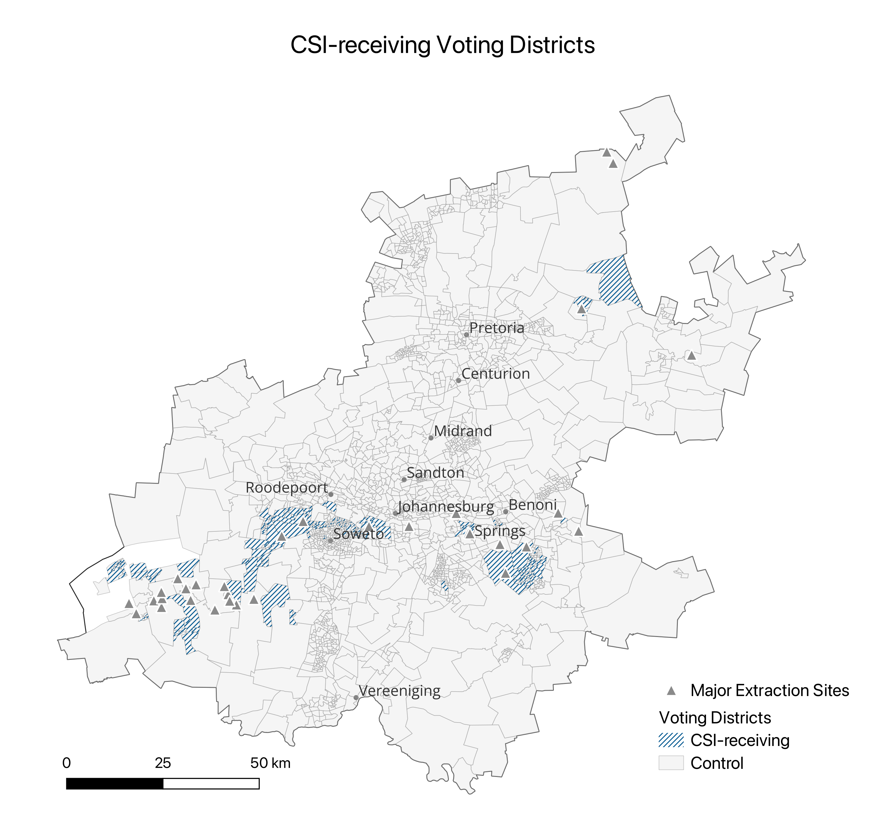
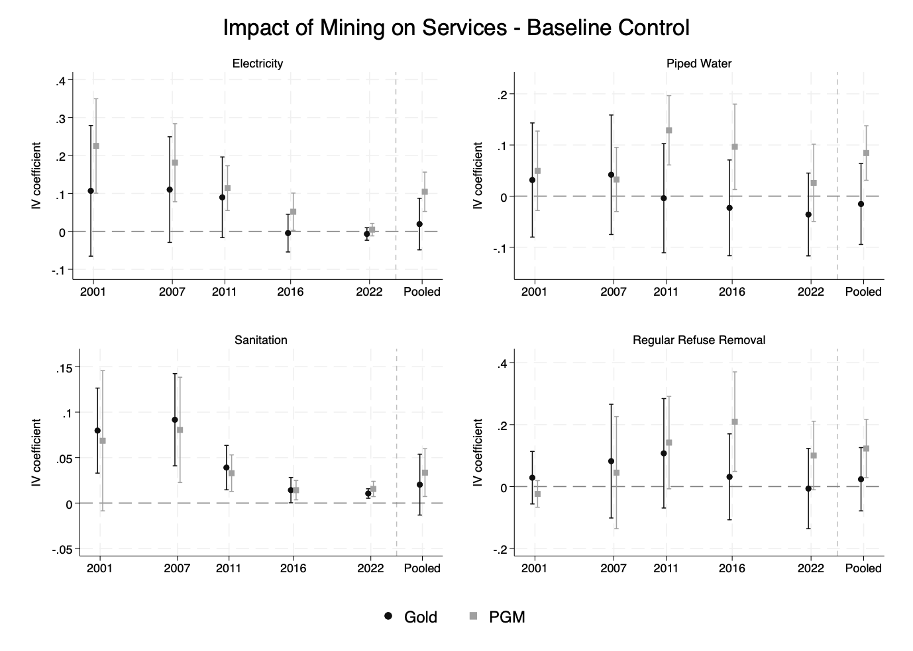
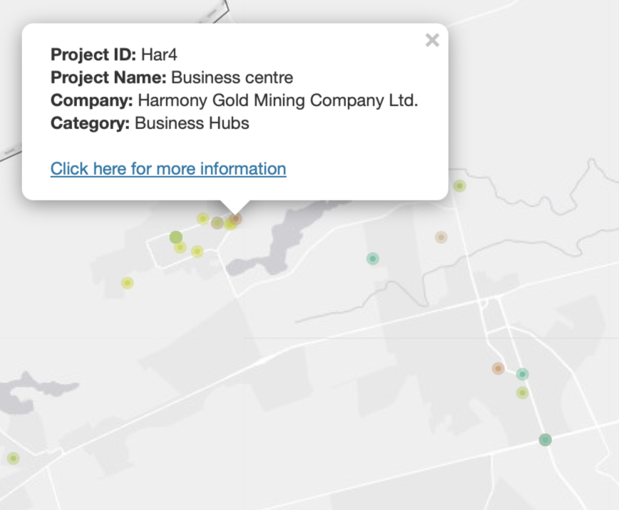
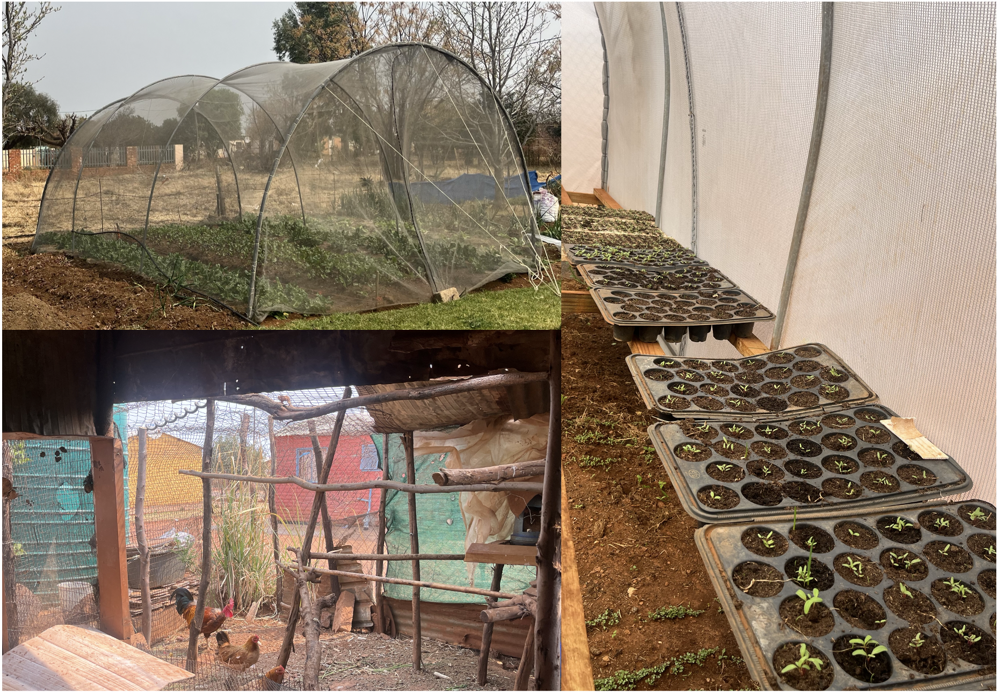

## Research Interests

- Development Economics
- Natural Resource Economics
- Political Economy
- Local Economic Development
- Corporate Social Responsibility

## Current Papers

::: {.paper-container}

::: {.paper-image}
{fig-alt="Mining communities in South Africa"}
:::

::: {.paper-content}

### The Limits of Firm-Led Development: Evidence from South African Mining Communities

[Draft](https://drive.google.com/file/d/1Su8FBmJKlBsRZP-Xc4hiRn4sGrQ9kLhz/view?usp=share_link) 

*Work in progress — Job Market Paper / Thesis Chapter*

Abstract

This paper evaluates the impact of mining companies’ Local Economic Development programmes (LEDs), which aim to increase incomes and reduce poverty in host communities by promoting alternative livelihood strategies and entrepreneurship. I compile a novel LED project database and combine it with seven waves of geo-coded household data from South Africa’s Gauteng Province. Using an event-study framework, I compare outcomes in LED-receiving areas before and after project implementation. The results show persistent improvements in food security and an increased likelihood of receiving an income. However, effects on business ownership are short-lived, while employment and average income levels remain largely unchanged. The results are driven by Alternative Livelihoods Programmes (ALPs), which promote income diversification. The results suggest that LEDs can reduce markers of absolute deprivation, yet fall short of delivering fundamental change.

:::

:::

::: {.paper-container}

::: {.paper-image}
{fig-alt="Community political participation"}
:::

::: {.paper-content}

### Corporate Social Investment, Political Participation, and Trust in Local Government

**Draft:** Available upon request

*Work in progress — Thesis Chapter*

Abstract

**Abstract:** Through Corporate Social Investment (CSI), companies seek to contribute to the development of their operating areas, taking over responsibilities usually held by local governments. This paper investigates whether CSI affects citizens' government perception and political participation at the local level. I focus on mining-related CSI in South Africa's Gauteng Province and combine information on CSI projects with household survey and electoral data. Using an event-study design, I estimate the effects of CSI on political participation, as well as trust in and satisfaction with local government. The results suggest that CSI projects increase community-level political participation, measured by attendance at community meetings, but have no meaningful impact on government trust or satisfaction. CSI-receiving areas show higher participation in subsequent municipal and ward elections, suggesting spillovers to electoral participation. Together, these findings suggest that CSI can mobilise citizens to participate more actively in local politics without weakening trust in government institutions.

:::

:::

::: {.paper-container}

::: {.paper-image}
{fig-alt="Mining and public service provision"}
:::

::: {.paper-content}

### Can Large-Scale Mining Promote Public Good Provision? Evidence from South Africa's Mining Reform

**Draft:** Available upon request

*Work in progress — Thesis Chapter*

Abstract

**Abstract:** This paper examines whether mining can strengthen local service delivery when companies are required to invest in local public goods. I use South Africa as a case study, where post-apartheid reforms introduced such requirements alongside a fundamental overhaul of local governance and service delivery, providing a useful starting point for examining this question. Using census data from 2001 to 2022, I compare access to basic services across mining and non-mining municipalities,
focusing on gold and Platinum-Group Metals (PGM) mining and four services: electricity, water, sanitation, and refuse removal. I instrument mining presence with municipalities’ overlap with exogenously determined mineral deposits and control for baseline levels of service provision. I find that PGM mining post-apartheid is associated with significantly higher access to basic services, while the evidence is weaker for gold mining. These effects are not explained by increases in municipal revenues or improvements in institutional quality. Instead, the findings are consistent with a combination of additional mining-related investment and a broader crowding-in effect, whereby mining activity stimulates public investment in service infrastructure in mining areas.

:::

:::

## Other Projects

::: {.paper-container}

::: {.paper-image}
{fig-alt="Community investment tracker"}
:::

::: {.paper-content}

### Community Investment Tracker

[CSI Tracker](https://rhinsching.shinyapps.io/project_webpage/) | [Code](https://github.com/rabeahinsching/CSI_Database)

*Ongoing data project*

**Description:** This project builds a structured dataset of mining companies’ Corporate Social Investment (CSI) projects collected from corporate reports using a GPT-based extraction algorithm. Part of the data is visualised in an online tracker to map investments, identify overlaps, and highlight underserved areas.

:::

:::

::: {.paper-container}

::: {.paper-image}
{fig-alt="Community livelihood programme"}
:::

::: {.paper-content}

### Assessing the Impact of the Broad-Based Livelihood Programme in Gauteng’s East Rand Mining Communities

**Collaboration:** Umsizi Sustainable Solutions

*Work in progress*

:::

:::
